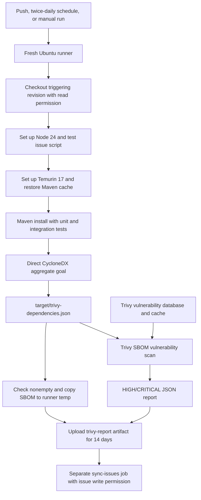

# Trivy scan job: low-level design and review

Reviewed on 2026-11-12 against the current working-tree version of
[`trivy.yml`](../workflows/trivy.yml), including its uncommitted changes.
This document describes the implementation and proposes improvements; it does
not change the workflow or POMs. Reasons behind existing decisions are inferred
from the code and comments, rather than a claim about the original author's intent.

## 1. Purpose and current findings

The `scan` job builds the active Maven reactor, generates a dependency inventory
as a CycloneDX software bill of materials (SBOM), checks that inventory for known
HIGH/CRITICAL vulnerabilities, and publishes the inventory and findings for
`sync-issues`. Vulnerability findings are expected output. Build, test and scanner
errors stop the pipeline.

There are two immediate correctness problems in the reviewed working tree:

1. **The build is blocked by malformed XML.** In
   [`maven/pom.xml`](../../maven/pom.xml), the `lifecycle-mapping` plugin and
   surrounding `plugins` element are not closed before `</pluginManagement>`.
   XML parsing fails at line 148. Since `maven` is a reactor module, the Maven
   build cannot complete, and the scan and issue jobs cannot produce results.
2. **The direct SBOM command does not explicitly include test scope.**
   [`pom.xml`](../../pom.xml) sets `includeTestScope=true` inside a
   package-phase execution under `pluginManagement`. The workflow invokes
   `cyclonedx:makeAggregateBom` directly, using Maven's `default-cli` execution.
   The cached external parent `2.10.0-M4.3` manages CycloneDX `2.9.3` without a
   plugin-level test-scope override; that plugin defaults to excluding tests.
   After fixing the XML, the direct invocation is therefore configured to exclude
   test-scoped dependencies, despite the step's name. Add
   `-DincludeTestScope=true` to this invocation to meet its stated requirement.
   Maven documents the [separate command-line execution configuration](https://maven.apache.org/guides/mini/guide-default-execution-ids.html),
   and the [CycloneDX 2.9.3 implementation](https://github.com/CycloneDX/cyclonedx-maven-plugin/blob/cyclonedx-maven-plugin-2.9.3/src/main/java/org/cyclonedx/maven/BaseCycloneDxMojo.java)
   confirms the default.

The workflow comment and existing scripts README also say that the normal
package-phase SBOM excludes test scope. The current root POM says `true`, so that
description has drifted from the implementation. The desired production SBOM
scope needs to be distinguished from the security scan's broader scope.

The remaining sections describe execution once the XML blocker is resolved.

## 2. Execution and data flow



Steps execute sequentially. Without an explicit condition overriding the default,
a failed step prevents later scanning/upload steps. `sync-issues` has
`needs: scan`, so it runs only after a successful scan job.

| Item | Producer | Consumer and purpose |
| --- | --- | --- |
| Checked-out revision and POMs | Checkout | Maven constructs the active reactor and dependency graph. |
| Local Maven repository | Cache restore and `mvn install` | Dependency resolution and sibling-module artifacts for the separate SBOM invocation. |
| `target/trivy-dependencies.json` | CycloneDX | The only package inventory Trivy scans. |
| `$RUNNER_TEMP/trivy-reports/dependency-sbom.json` | Copy step | Archived copy of the inventory actually supplied to Trivy. |
| `$RUNNER_TEMP/trivy-reports/trivy-report.json` | Trivy | Filtered findings consumed by the issue script. |
| Artifact named `trivy-report` | Upload action | Transfers both JSON files to the separate issue job and allows human inspection. |

### Trigger behavior

| Configuration | Behavior | Reason and tradeoff |
| --- | --- | --- |
| `push: {}` | Runs for branch and tag pushes, with no branch/path filters. | Detects dependency changes across development and release refs; also rebuilds after unrelated edits and can create issues from experimental branches. |
| `cron: "17 6,18 * * *"` | Scans the default branch at 06:17 and 18:17 UTC. | Finds newly published advisories without a code change. Minute 17 avoids the start-of-hour peak, but execution is not guaranteed at an exact time. |
| `workflow_dispatch` | Allows a selected ref to be scanned manually. | Useful for validation and investigation; still performs the complete build and scan. |
| `dry_run`, default `true` | Only suppresses issue creation for manual runs. | Provides a preview of issue writes, with the same scan cost. Pushes and scheduled runs do not get this protection. |
| No `pull_request` event | No automatic upstream scan for a fork PR. | Reduces duplicate runs, but this workflow alone does not provide a PR security check for external contributions. |

GitHub's [event reference](https://docs.github.com/en/actions/reference/workflows-and-actions/events-that-trigger-workflows#schedule)
documents default-branch scheduling and possible delays or dropped scheduled runs.

## 3. Runner, checkout and helper validation

| Option | What it does | Why choose it; tradeoff |
| --- | --- | --- |
| `runs-on: ubuntu-latest` | Uses a hosted Linux environment. | Convenient tooling and a fresh workspace. The image and bundled Maven can change, so the environment is not fully reproducible. |
| `timeout-minutes: 120` | Caps the complete scan job. | Allows the reactor build and integration tests to finish. A broken/hanging build can occupy a runner for a long time; there is no measured runtime here proving 120 minutes is necessary. |
| Workflow `contents: read` | Gives the scan job a read-only repository token. | The build does not need issue-write privileges. Artifact upload uses the Actions artifact service; it does not require `issues: write`. |
| Full commit SHAs on actions | Selects immutable action revisions. | Makes updates deliberate and reviewable; maintaining pins needs automation or regular review. Version comments are labels, while the SHA determines the code. |
| Checkout `persist-credentials: false` | Does not retain checkout authentication in Git configuration after checkout. | Subsequent build commands have less opportunity to reuse that Git credential. Authenticated Git operations later would need explicit setup. |
| Node `node-version: "24"` | Supplies the runtime for `node --test`. | Matches the documented local test runtime. Node's patch version can change. This is tooling for the issue script, not a Node application scan. |
| `package-manager-cache: false` | Disables package-manager caching in setup-node. | The tests use Node built-ins and require no `npm install`; caching adds no value here. |
| `node --test ...trivy-issues.test.cjs` | Runs mocked tests of the report consumer before the expensive Java build. | Quickly catches regressions in deduplication/report handling. A helper-test failure also prevents vulnerability scanning, coupling the two concerns. |

The separate issue job is a useful permission boundary: Maven and its tests run
without the token privileges needed to create issues. This does not make the
build a sandbox; build plugins and test code still execute on the runner.

## 4. Maven build and dependency resolution

### Java and cache options

| Option | Meaning | Reason and tradeoff |
| --- | --- | --- |
| `distribution: temurin` | Uses Eclipse Temurin's JDK. | A consistent vendor across runs; it tests only this vendor's behavior. |
| `java-version: "17"` | Runs Maven and tests on Java 17. | A fixed Java major reduces environment variation. The root compiler target remains Java 11 through `java.release`; build JDK and bytecode target are different settings. This is not a multi-JDK compatibility test. |
| `cache: maven` | Restores/saves the local Maven dependency repository. | Reduces repeated downloads. A cache hit still runs the build, and cold/missing dependencies still require repository access. |
| `cache-dependency-path: "**/pom.xml"` | Uses POM files throughout the repository in cache-key calculation. | Tracks nested-module dependency changes. Fixture-only changes may invalidate the cache too; a cache is a performance aid, not a dependency lockfile. |

### Build command

```bash
mvn --batch-mode --no-transfer-progress -PIT,it-store-file \
  -DskipTests=false -Dmaven.test.skip=false -DskipITs=false install
```

| Argument | Meaning | Reason and tradeoff |
| --- | --- | --- |
| `--batch-mode` | Disables interactive execution behavior. | Suitable for unattended CI. |
| `--no-transfer-progress` | Hides artifact download progress updates. | Keeps logs readable while preserving errors; less live download detail. |
| `-PIT,it-store-file` | Activates integration testing and a file-backed embedded store. | The inherited `IT` profile binds Failsafe; `maven/pom.xml` adds Invoker tests. The file store avoids provisioning a remote Neo4j service but does not test a remote deployment. |
| `-DskipTests=false` | Requests test execution through the standard skip-tests property. | Makes test intent explicit; adds test runtime. |
| `-Dmaven.test.skip=false` | Requests that test compilation/execution not be disabled through this separate property. | Covers another common skip switch. It does not prove that every custom plugin or test selection runs every possible test. |
| `-DskipITs=false` | Requests integration-test execution through the standard IT skip property. | Protects the intended Failsafe path; fixtures and other plugins still follow their own configuration. |
| `install` | Executes lifecycle phases through packaging, verification and installation into the local Maven repository. | The separate Maven process can resolve sibling-module artifacts. It costs more than generating an inventory from POMs, but does not publish a release to a remote repository. |

**Decision assessment:** building/installing a multi-module reactor before a
separate dependency-resolution command is reasonable. Requiring all tests is a
separate policy choice. Tests can validate the code, but do not make a dependency
appear in the SBOM unless the SBOM configuration includes it.

I would retain the full test run if this job must certify both build health and
dependency security. For continuous advisory monitoring, I would consider
separating test status from inventory generation so an unrelated test failure does
not suppress alerts. That alternative still needs a reliable reactor build and
dependency-resolution strategy; simply deleting `install` can break sibling
artifact resolution. The existing CI workflow is another place where build/test
work may overlap, although its reusable workflow was not expanded in this review.

## 5. Dependency inventory generation

Current invocation:

```bash
mvn --batch-mode --no-transfer-progress -PIT,it-store-file \
  cyclonedx:makeAggregateBom -DoutputFormat=json \
  -DoutputName=trivy-dependencies -DoutputReactorProjects=false \
  -Dcyclonedx.skipAttach=true
```

| Argument or operation | Meaning | Reason and tradeoff |
| --- | --- | --- |
| Same active profiles | Constructs the inventory for the same selected build model. | Helps align build and inventory, while leaving inactive configurations outside coverage. |
| `cyclonedx:makeAggregateBom` | Aggregates dependencies across the current Maven reactor. | Avoids scanning only one module. It requires accurate Maven resolution and does not recursively inventory every POM file in the checkout. |
| `-DoutputFormat=json` | Generates CycloneDX JSON. | Compatible with this Trivy input path and easy to inspect programmatically. |
| `-DoutputName=trivy-dependencies` | Chooses a distinct output basename under the root build directory. | Avoids confusing this scan inventory with ordinary `bom.json` outputs. |
| `-DoutputReactorProjects=false` | Suppresses separate module-only BOM files. | Reduces output and upload noise; module dependencies remain in the aggregate. Per-module inventories could be useful for ownership and distribution analysis. |
| `-Dcyclonedx.skipAttach=true` | Does not attach this BOM as a Maven artifact. | Keeps a scan-specific report separate from artifact publication. This does not disable local file generation. |
| `test -s ...` | Requires a nonempty SBOM file. | Detects missing/empty output. It does not validate JSON, component count or scope completeness. |
| Copy to `$RUNNER_TEMP` | Stages the exact scan input in the artifact directory. | Makes input and output available together; another file copy and path must remain consistent. |

**Recommended minimal command adjustment:** add `-DincludeTestScope=true` to
the direct invocation. Compile, provided, runtime and system scopes are already
enabled by the inspected plugin's defaults. Explicitly setting all scope flags
would make policy more visible, at the cost of a longer command. See
[CycloneDX parameter definitions](https://cyclonedx.github.io/cyclonedx-maven-plugin/makeAggregateBom-mojo.html)
for the output and attachment controls.

### Coverage boundary

With test inclusion corrected, the intended inventory contains resolved direct
and transitive project dependencies for the active reactor, including test scope.
It does not automatically cover:

- Inactive profiles or alternative Java/OS-dependent dependency graphs.
- Standalone test fixture projects launched by Invoker; executing a nested build
  does not add that build's dependency graph to the top-level reactor SBOM.
- Every Maven plugin, build extension or dependency of those tools.
- The runner's OS packages, JDK installation or Node installation.
- Secrets, source-code security defects or deployment misconfigurations.

Test dependencies can be relevant because they execute in CI, but their findings
should be triaged differently from dependencies shipped to users. An aggregate
report also does not guarantee that the issue consumer retains a precise
source-module attribution for every dependency.

## 6. Trivy scan options

The action scans the generated inventory; it does not rediscover dependencies
from all source POMs at this stage. The following table explains the options
present in the workflow.

| Option | Effect | Why choose it; tradeoff |
| --- | --- | --- |
| `scan-type: sbom` | Uses the SBOM scan mode. | Maven resolves the graph and Trivy matches inventory entries to advisories. Packages missing from the SBOM cannot be recovered by this scan. |
| `scan-ref: target/trivy-dependencies.json` | Selects that aggregate inventory. | Keeps the target deterministic and excludes unrelated files. Accuracy depends on the generation step. |
| `scanners: vuln` | Enables dependency vulnerability checks. | Keeps this job focused. Secret, license and misconfiguration checks need their own appropriate inputs and configuration. |
| `TRIVY_INCLUDE_DEV_DEPS: "true"` | Signals development-dependency inclusion where supported. | It cannot add Maven test dependencies that CycloneDX omitted. Treat producer-side `includeTestScope` and inventory validation as the actual coverage controls. |
| `severity: HIGH,CRITICAL` | Filters the vulnerability report to these severity levels. | Reduces issue volume. LOW/MEDIUM/UNKNOWN findings are absent from this report, even though lower-rated findings can matter in context. |
| `ignore-unfixed: false` | Keeps matching findings without a published fix. | Preserves risk visibility and allows mitigations or dependency replacement. Some tickets will have no upgrade available. |
| `format: json` | Writes structured Trivy output. | Matches the custom issue parser. A separate SARIF path would be needed for a Code Scanning presentation. |
| `output: .../trivy-report.json` | Writes findings directly to the artifact staging directory. | Avoids scraping logs. Producing a file does not itself guarantee its schema or completeness. |
| `cache-dir: .../trivy-cache` | Selects a separate cache directory in runner temp. | Keeps cache data out of the uploaded report directory and checkout. This is independent of the Maven cache. |
| `timeout: 20m` | Limits Trivy's operation. | Gives downloads/scanning room to finish and bounds hangs. It does not reserve 20 minutes within the 120-minute job cap or cover every setup step. |
| `exit-code: "0"` | Makes discovered vulnerabilities a successful scan outcome. | Lets findings reach `sync-issues`. It does not turn scanner operational errors into successful results. It also means a green job does not certify that dependencies are vulnerability-free. |

The [Trivy SBOM documentation](https://trivy.dev/docs/latest/target/sbom/)
confirms JSON CycloneDX support and cautions that inventories produced by other
tools can reduce detection accuracy. Validate representative Maven package
identities and findings when changing the producer or scanner.

### Defaults inherited from the pinned action

The [exact action revision](https://github.com/aquasecurity/trivy-action/blob/ed142fd0673e97e23eac54620cfb913e5ce36c25/action.yaml)
defaults to Trivy `v0.70.0` and enables caching. Its database cache uses the
configured directory, daily cache keys and an older-cache fallback. Therefore,
using runner temp does not mean database downloads always start from nothing.
Database update checks are not disabled by this workflow.

The scanner version is indirectly selected by the immutable action revision; it
is not an unbounded `latest` version. Adding an explicit `version` would make it
more visible but would create another value to maintain. Database contents and
resolved mutable dependencies can still change between scans of the same commit.

## 7. Artifact contract and issue handoff

| Option | Meaning | Reason and tradeoff |
| --- | --- | --- |
| `name: trivy-report` | Names the artifact used by the dependent job. | A stable contract; producer and consumer names must match. |
| `path: .../trivy-reports/` | Uploads the staged SBOM and vulnerability report. | Preserves both input and output for review without uploading the vulnerability DB. |
| `if-no-files-found: error` | Fails if the selected path has no files. | Prevents a completely empty handoff. The SBOM alone satisfies this check, so it does not guarantee `trivy-report.json` exists. |
| `retention-days: 14` | Retains this run's artifact for two weeks, subject to repository policy. | Limits retained storage. Issues can outlive their downloadable evidence. |

The issue job downloads this run's artifact, parses the report and calls
[`trivy-issues.cjs`](trivy-issues.cjs). That consumer expects `SchemaVersion: 2`
and validates finding fields before issue writes. It deduplicates by normalized
ecosystem, package and advisory across versions, branches and modules. It skips
already marked open or closed issues, rather than updating/reopening them.

Keeping this handoff separate allows scans to overlap while issue synchronization
is serialized. The tradeoff is another runner, an artifact transfer, and an
eventual issue list whose existing tickets are not continuously refreshed.

## 8. Failure semantics

| Situation | `scan` result | Issue synchronization |
| --- | --- | --- |
| Malformed reactor POM, dependency resolution error or failed Maven test | Failed before scanning | Skipped |
| Issue-script unit test fails | Failed before Java build | Skipped |
| SBOM command fails or output is empty | Failed | Skipped |
| Trivy database access, parsing, timeout or other operational error | Failed | Skipped |
| Valid scan reports HIGH/CRITICAL findings | Successful if upload succeeds | Runs; may create issues |
| Valid scan reports no findings at the selected severity | Successful if upload succeeds | Runs; creates none |
| Artifact upload fails | Failed | Skipped |
| Missing/malformed vulnerability report nevertheless gets uploaded with the SBOM | May succeed | Consumer fails reading/validating it |
| Manual dry run with valid findings | Successful if upload succeeds | Reports planned creations; performs no issue writes |

The upload step has no `if: always()`, so earlier failures do not normally retain
partial reports. This prevents partial output being mistaken for a completed
scan, but reduces diagnostic evidence. A separate failure-only diagnostic upload
could help without feeding incomplete results into issue synchronization.

## 9. Alternatives and design recommendations

| Decision | Current approach | Alternative and when I would choose it |
| --- | --- | --- |
| Inventory source | Maven-generated aggregate SBOM | Trivy filesystem/POM scanning for simpler setup, after validating reactor resolution and coverage. Built archives for packaged-runtime coverage, with a separate path for tests. |
| Build/test coupling | All tests must pass before scanning | Separate test status when security monitoring must continue despite unrelated test failures. Keep equivalent inventory resolution and scope checks. |
| Vulnerability policy | Report findings without failing the scan | A separate gate after report publication/issue synchronization when branch or release policy requires blocking vulnerable changes. Changing this step to `exit-code: 1` alone skips `sync-issues` under the current dependency graph. |
| Severity selection | Store only HIGH/CRITICAL findings | Retain all severities in a raw report and filter in the issue consumer when a complete audit trail is needed. This requires consumer changes because it currently processes every supplied finding. |
| Scope | Intended production plus test dependencies | Separate runtime and test reports when ownership, remediation priority or release policy differs. This adds report management and attribution work. |
| Reproducibility | Pinned actions and major runtimes | Pin the runner image family and Maven/JDK patch tooling more explicitly when stable reproduction is required; maintain updates deliberately. |
| Run frequency | Every push plus twice daily | Restrict pushes to maintained branches when CI cost and experimental-branch noise outweigh the benefit of immediate scans everywhere. Preserve scheduled rescans for new advisories. |

Recommended order of work:

1. Repair the malformed Maven XML so the reactor can be read.
2. Make `includeTestScope=true` explicit on the security SBOM command and align
   the workflow comments/README with the actual production SBOM configuration.
3. Validate that both expected JSON files exist and parse successfully before
   upload. Validate the inventory's component coverage, not just its file size.
4. Keep the SBOM/report handoff, restricted scan permissions and non-failing
   findings policy for this issue-creation design.
5. Decide whether full test success is a security-monitoring prerequisite and
   whether 14-day evidence retention is enough for the issue lifecycle.

## 10. Verification plan and review limits

This review parsed the two relevant local POMs, inspected the cached parent POM
and CycloneDX plugin descriptor, read the issue consumer and workflow, and checked
the Maven/CycloneDX/Trivy documentation and pinned action source. The root POM is
well-formed; `maven/pom.xml` is not. No Maven build, vulnerability scan or GitHub
issue writes were performed. No findings count or runtime is asserted.

After correcting the configuration, verify these behaviors in a manual dry run:

1. The full reactor builds with the intended profiles and test execution.
2. The aggregate SBOM contains independently selected direct and transitive
   dependencies, including packages introduced only through test scope.
3. The inventory's Maven scope metadata includes `test`; inactive profiles and
   standalone fixture graphs are not assumed covered without separate evidence.
4. A controlled known-vulnerable Maven component matches the expected advisory,
   including an unfixed case when available in the current database.
5. The artifact contains valid `dependency-sbom.json` and `trivy-report.json`;
   the latter is compatible with the consumer's schema checks.
6. Findings leave `scan` successful, while a genuine build/scanner failure blocks
   issue synchronization. Dry-run mode produces no new issues.
7. Reusing an identical saved report does not create duplicate issues; use a fixed
   report for this check because live vulnerability databases change.
